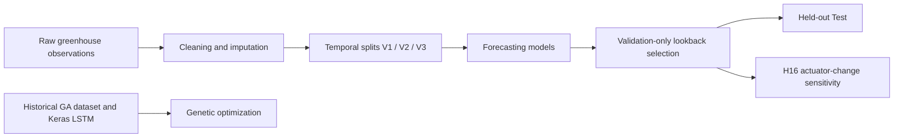

# Predictive Analytics and Evolutionary Optimization for Greenhouse Climate Control

**Research code, experimental data, trained models, and reproducibility evidence** accompanying the manuscript *A Data-Driven Predictive Analytics Framework for Sustainable Greenhouse Climate Control Using Deep Learning and Evolutionary Optimization* (Ecological Informatics, manuscript **ECOINF-D-26-02633**).

This repository documents an end-to-end workflow: greenhouse sensor data quality control, multivariate forecasting, actuator-change sensitivity analysis, and genetic-algorithm-based control optimization.

> **Research status:** This is the code and evidence repository for a manuscript under revision. Publicly available artifacts reflect the original experiments; any deviations, alternative datasets, or historical naming conventions are stated below rather than silently harmonized.

## At a glance

| Component | Scope | Available evidence |
|:--|:--|:--|
| [Preprocessing](preprocessing/) | Quality control, short-gap reconstruction, and temporal partitioning | Original/processed datasets, audits, sensitivity analysis, figures, tests |
| [Forecasting](forecasting/) | LSTM, iTransformer, PatchTST-MV, and Persistence baseline | **2,430** Validation runs; **81** selected configurations; **405** Test evaluations; **405** selected checkpoints |
| [Actuator-change sensitivity](forecasting/experiments/actuator_change_sensitivity/) | H16 retrospective OBS / MASK / SUST analysis | **45** model/seed evaluations, **172** candidate episodes, paired prediction records and figures |
| [Optimization](optimization/) | One engineering-aware genetic algorithm, using its original LSTM surrogate | **36** tuning configurations, original aggregate results, configurations and checkpoint |



**Important:** The optimization branch uses a *separate historical dataset and TensorFlow/Keras LSTM*. The diagram does **not** indicate that the GA used the PyTorch forecasting checkpoints.

## Repository structure

```text
.
├── .gitignore
├── preprocessing/
│   ├── data/                    # original and processed greenhouse records
│   ├── scripts/                 # preprocessing, audits, figure generation
│   ├── results/                 # reproducibility audits and figures
│   └── tests/
├── forecasting/
│   ├── architectures.py        # neural-network architecture definitions
│   ├── models.py               # the three published forecasting models
│   ├── data.py                 # partitions, scaling, windows, origins
│   ├── metrics.py              # evaluation metrics
│   ├── pipeline.py             # train / select / authorized Test workflow
│   ├── config.json             # experiment settings
│   ├── splits.json             # frozen temporal partitions
│   ├── checkpoints/            # 405 selected PyTorch checkpoints + hashes
│   ├── results/                # Validation / Test / Persistence tables
│   ├── experiments/
│   │   └── actuator_change_sensitivity/
│   └── tests/
└── optimization/
    ├── genetic_algorithm_class.py
    ├── run_selected_ga.py
    ├── run_tuning_grid.py
    ├── selected_ga_config.json
    ├── tuning_grid_config.json
    ├── results/tuning_results.csv
    ├── models/                 # historical TensorFlow/Keras checkpoint
    ├── datasets/               # historical GA dataset
    └── tests/
```

## 1. Greenhouse data and preprocessing

The canonical forecasting dataset is [`preprocessing/data/processed/ETIFA_clean_imputed_1h.csv`](preprocessing/data/processed/ETIFA_clean_imputed_1h.csv). Its measurements follow a **15-minute cadence**; the `1h` in the filename refers to the **maximum short-gap reconstruction length**, not hourly sampling. Quality control includes sensor validation, physically informed consistency checks, limited interpolation for short gaps, circular treatment of wind direction, and auditing of missingness.

Three frozen, temporally separated Train/Validation/Test arrangements (**V1**, **V2**, **V3**) are defined in [`forecasting/splits.json`](forecasting/splits.json). Evaluation windows and train-derived normalizers follow the public experimental protocol. Consult the [preprocessing scripts](preprocessing/scripts/) and [forecasting data module](forecasting/data.py) for exact rules.

## 2. Predictive models and evaluation

**Models:** LSTM (implementation ID `lstm_sergiot`), iTransformer (`itransformer`), PatchTST-MV (`patchtst_mv`); Persistence is reported as an untrained baseline. The legacy `lstm_original` is **not** included as a fourth neural architecture.

- **Inputs:** nine environmental sensor variables, six historical actuator variables, and four cyclic time features (**19 input channels**).
- **Outputs:** nine environmental targets.
- **Forecast horizons (15-minute steps):** `4, 8, 16, 24, 48, 96, 144, 192, 288`.
- **Candidate lookbacks:** `48, 96, 192, 288, 384, 672`.
- **Seeds:** `8, 13, 22, 27, 31`.
- **Selection:** for each dataset version × model × horizon, minimize **mean global Validation nMAE-IQR** over five seeds, with standard deviation and smaller lookback as tie-breakers. **Test is not consulted when selecting lookbacks.**

Training uses complete windows; Validation/Test apply the documented future-actuator stability restrictions for retrospective evaluation. The model's assessment is observational and should not be read as causal identification.

### Experimental provenance

| Dataset version | Training environment for published Validation results | Runs |
|:--|:--|--:|
| V1 | SIRIUS 1 | 810 |
| V2 | Ubuntu RTX 5080 | 810 |
| V3 | SIRIUS 2 | 810 |
| **Total** | | **2,430** |

The consolidated [Validation and Test results](forecasting/results/) include 81 Validation-selected lookbacks, 405 Test model/seed evaluations (81 combinations × five seeds), and 27 Persistence comparisons. Model weights are provided in [`forecasting/checkpoints/`](forecasting/checkpoints/) with a [SHA-256 manifest](forecasting/checkpoints/manifest.csv). See the [results provenance notes](forecasting/results/README.md) for the source campaigns and cross-checks.

### Basic commands

Use a supported Python/PyTorch environment (see [`forecasting/requirements.txt`](forecasting/requirements.txt)); run from the repository root:

```bash
python -m forecasting.pipeline preflight
python -m forecasting.pipeline jobs
python -m unittest discover -s forecasting/tests -p 'test_*.py' -v
```

The `pipeline.py` workflow includes separate train/Validation, frozen model selection, and explicitly authorized Test commands. **Do not reselect lookbacks using Test or rerun the original campaign merely to inspect the published tables.** See the `pipeline.py` CLI help and module docstring before launching any expensive computation.

## 3. Actuator-Change Sensitivity Analysis (H16)

This **retrospective conditional sensitivity analysis** studies whether perturbing a past actuator change affects the prediction error for dry-bulb temperature (TBS) and relative humidity (RH) over a four-hour forecast horizon.

| Condition | Intervention on the selected historical actuator |
|:--|:--|
| **OBS** | Preserve the observed input history |
| **MASK** | Replace the most recent changed value by the preceding value |
| **SUST** | Replace the final 16 historical values by the pre-change value |

The experiment uses nine H16 selected model configurations, five seeds each (**45 checkpoints**), and **75 / 37 / 60** candidate episodes for V1 / V2 / V3. Episode eligibility uses a single detected actuator change and subsequently stable actuation; **future actuator observations are used only for retrospective episode selection**, not provided as model inputs.

An *increase* in error relative to OBS is consistent with the predictor benefiting from the changed-actuator information; equal or lower error is **not** positive evidence for this hypothesis. These are sensitivity comparisons, **not causal effects**. The event-change thresholds reproduce the historical candidate definition and still require a clear physical/methodological justification in the manuscript.

Recalculate the archived evidence checks, audit candidate episodes, and reproduce one GPU inference case:

```bash
python forecasting/experiments/actuator_change_sensitivity/verify_results.py
python forecasting/experiments/actuator_change_sensitivity/run.py
python forecasting/experiments/actuator_change_sensitivity/run.py --smoke --device cuda
```

The smoke comparison passed on the Ubuntu GPU for OBS, MASK, and SUST with a maximum physical-unit discrepancy of approximately `3.81e-6` for the checked LSTM case. This is **not a claim that all 45 model/seed runs were recomputed**. See the [experiment documentation](forecasting/experiments/actuator_change_sensitivity/README.md) for the protocol and evidence files.

## 4. Genetic-algorithm optimization

The released optimizer contains **one** selected technique, `GA_ENGINEERING_AWARE`, with engineering-aware constraints and an actuator-effort/energy proxy. Its surrogate is a **historical TensorFlow/Keras LSTM**, which is **not** the same checkpoint or input architecture as the PyTorch LSTM reported in the forecasting comparison.

- **Real surrogate input:** 96 prior 15-minute observations × 17 features.
- **Surrogate output:** nine predicted environmental variables **one step ahead**.
- **Control experiment:** 12 sequential 15-minute optimization decisions (three hours).
- **Tuning:** 36 parameter configurations × three episodes × five seeds = **540 cases**.
- **Selected published configuration:** population `200`, generations `50`, tournament size `2`, conservative mutation profile, Gaussian scale fraction `0.04`.
- **Selection criterion:** minimum mean best fitness among the 36 configurations. Original aggregate: approximately **0.0925904**.

### Critical artifact-name qualification

The published historical artifacts have requested filenames that **do not describe their actual scientific content**:

| File currently in the repository | Verified original identity | Scientific meaning |
|:--|:--|:--|
| `optimization/models/LSTM_L48_H1.h5` | Original `model_lstm_lb96.h5` | **Actual lookback 96**, one-step prediction, 17 input features |
| `optimization/datasets/ETIFA_clean_imputed_1h.csv` | Original `DIRTY-DS-15-SUMMER.csv` | **Historical GA data**, distinct from the canonical forecasting dataset of the same filename |

A filename change **does not** change model weights, input shape, data provenance, or sampling protocol. The two identically named CSVs under `preprocessing/` and `optimization/` must not be treated as identical. Details and SHA-256 hashes are provided in [`optimization/README.md`](optimization/README.md).

### Inspect and test without rerunning the tuning grid

The GA requires a **separate Python 3.10 TensorFlow environment**, described in [`optimization/requirements.txt`](optimization/requirements.txt). Run from the repository root:

```bash
python optimization/run_selected_ga.py --case-count  # 15
python optimization/run_tuning_grid.py --config-count # 36
PYTHONPATH=optimization python -m unittest discover -s optimization/tests -p 'test_*.py' -v
```

Full optimization runs are computationally more expensive and write to `optimization/out/` (ignored by Git). A historical single-case GA run has been functionally reproduced, but **exact numerical reproduction of the full historical GA trajectories has not been established**. See [Optimization](optimization/README.md) for the scope of the available evidence.

## Verification and software environments

From the repository root, in an environment with the required packages:

```bash
python -m unittest discover -s preprocessing/tests -p 'test_*.py' -v
python -m unittest discover -s forecasting/tests -p 'test_*.py' -v
PYTHONPATH=optimization python -m unittest discover -s optimization/tests -p 'test_*.py' -v
python forecasting/experiments/actuator_change_sensitivity/verify_results.py
```

These checks previously passed with **9 preprocessing + 8 forecasting + 8 GA tests** (25 total), plus independent sensitivity-result verification. Tests cover different assertions and are retained deliberately. Some tests are functional/protocol checks, not a full recomputation of every historical training run.

The published components have **different runtime requirements**: preprocessing/forecasting use current NumPy and PyTorch, while the historical optimization surrogate requires a pinned TensorFlow/TF-Keras setup and NumPy 1.x. Use separate virtual environments; do not attempt to install all component requirement files indiscriminately into one environment.

## Reproducibility, scope, and citation

- Results and models are provided alongside dataset provenance, frozen splits, configurations, and integrity checks.
- The original experiments include cluster- and workstation-specific execution environments; numerical behavior can vary across CPU/GPU backends. Compare results using the documented units and protocols rather than assuming bitwise-identical trajectories on every platform.
- The actuator-change event thresholds are a candidate historical definition and need explicit methodological explanation.
- The GA's renamed model/data artifacts **must not** be misrepresented as the canonical forecasting LSTM and dataset.
- **Citation:** *A Data-Driven Predictive Analytics Framework for Sustainable Greenhouse Climate Control Using Deep Learning and Evolutionary Optimization*, manuscript ECOINF-D-26-02633. A journal DOI and final bibliographic details should only be added after publication.

For task-specific scripts, outputs, and known limitations, follow the component-level documentation linked above.
