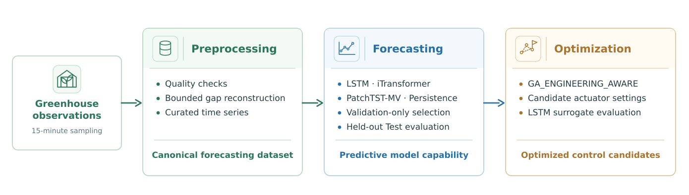
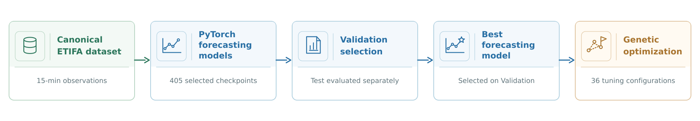

# **PGAF:** Predictive analytics and evolutionary optimization for greenhouse climate control

<p align="center">
  
</p>

**PGAF** explores how predictive models can support climate-control decisions in a greenhouse.
The research follows a connected workflow: observations are cleaned and reconstructed,
forecasting models learn the greenhouse climate response, and a **genetic algorithm (GA)**
uses a predictive surrogate to explore alternative actuator settings.

This repository accompanies *A Data-Driven Predictive Analytics Framework for Sustainable
Greenhouse Climate Control Using Deep Learning and Evolutionary Optimization*, submitted to
*Ecological Informatics* (**ECOINF-D-26-02633**, revised submission R1).

> **About the released experiments.** Forecasting and optimization are connected
> **methodologically**, but the archived GA experiments use a separate historical
> TensorFlow/Keras LSTM checkpoint and dataset. The PyTorch forecasting checkpoints
> are **not** directly loaded by the released GA implementation.
> See [artifact provenance](#-which-artifacts-belong-to-each-experiment).

## Quick start

Inspect the released code and verify the archived results **from the repository root**
in an environment with the appropriate dependencies:

```bash
# Unit, protocol and integrity checks
python -m unittest discover -s tests -p 'test_*.py' -v

# Verify saved actuator-change sensitivity results
python forecasting/experiments/actuator_change_sensitivity/verify_results.py

# Inspect GA experiment sizes without running optimization
python -m optimization.scripts.run_selected_ga --case-count
python -m optimization.scripts.run_tuning_grid --config-count
```

These commands do **not** retrain forecasting models or execute the full GA campaign.
For component-specific dependencies, consult [Preprocessing](preprocessing/README.md),
[Forecasting](forecasting/README.md) and [Optimization](optimization/README.md).
The historical GA surrogate requires a separate TensorFlow/TF-Keras environment.

## Index

- [Quick start](#quick-start)
- [Folders](#folders)
  - [Preprocessing](#preprocessing)
  - [Forecasting](#forecasting)
  - [Optimization](#optimization)
  - [Tests](#tests)
- [How does it work?](#how-does-it-work)
  - [Data preparation](#-data-preparation)
  - [Climate forecasting](#-climate-forecasting)
  - [Genetic optimization](#-genetic-optimization)
  - [Which artifacts belong to each experiment?](#-which-artifacts-belong-to-each-experiment)
- [Research evidence](#research-evidence)
- [Reproducibility and limitations](#reproducibility-and-limitations)
- [Citation and versioning](#citation-and-versioning)

---

# Folders

Four top-level folders keep the released components and their verification tools separate:

```text
preprocessing/     observations, cleaning, imputation, audits and figures
forecasting/       predictive models, checkpoints and evaluation results
optimization/      historical LSTM surrogate, GA and tuning results
tests/             unit, protocol and artifact-integrity checks
```

## [Preprocessing](preprocessing/)


The input to the forecasting study is a **15-minute greenhouse time series**.
Preprocessing checks observations, identifies invalid readings, reconstructs eligible
short gaps and records which values remain missing.

The inputs, processing code and results are retained together so data quality can be
inspected independently of model performance. Start with the
[Preprocessing guide](preprocessing/README.md).

<br clear="right">

<details>
<summary><b>What is inside:</b> datasets, scripts, audits and figures</summary>

```text
preprocessing/
├── data/
│   ├── raw/           original greenhouse observations
│   └── processed/     curated data and audits
├── scripts/           preprocessing and analysis tools
├── results/           quality-control reports and figures
├── requirements_preprocessing.txt
└── README.md
```

The canonical forecasting dataset is
[`ETIFA_clean_imputed_1h.csv`](preprocessing/data/processed/ETIFA_clean_imputed_1h.csv).
Despite its name, `1h` refers to the maximum eligible short-gap reconstruction;
sampling remains at **15-minute intervals**.

</details>

## [Forecasting](forecasting/)


This is the **predictive stage**. It implements **LSTM**, **iTransformer** and
**PatchTST-MV**, alongside a **Persistence** baseline. Historical environmental
observations, past actuator measurements and cyclic time features are used to
estimate future climate conditions.

Lookbacks are selected using **Validation**, never **Test**. The trained checkpoints
and evaluation tables are documented in the [Forecasting guide](forecasting/README.md).

<br clear="right">

<details>
<summary><b>What is inside:</b> models, configurations, checkpoints and results</summary>

```text
forecasting/
├── core/             architectures, models, data and metrics
├── scripts/          training and evaluation pipeline
├── checkpoints/      selected PyTorch model weights
├── results/          Validation, Test and Persistence tables
├── experiments/
│   └── actuator_change_sensitivity/
├── config.json
├── splits.json
├── requirements.txt
└── README.md
```

The H16 [actuator-change sensitivity experiment](forecasting/experiments/actuator_change_sensitivity/README.md)
examines whether altering recorded actuator-change information affects prediction
error. It is a retrospective sensitivity analysis, **not** a causal intervention.

</details>

## [Optimization](optimization/)


This is the **decision-search stage**. A genetic algorithm explores candidate
settings for six greenhouse actuators and evaluates them using an LSTM surrogate,
climate-target objectives and engineering-aware penalties.

The released experiment contains `GA_ENGINEERING_AWARE` and its tuning grid, using
a **historical TensorFlow/Keras LSTM and input dataset** described in the
[Optimization guide](optimization/README.md).

<br clear="right">

<details>
<summary><b>What is inside:</b> GA implementation and historical experimental evidence</summary>

```text
optimization/
├── core/             genetic algorithm and reusable utilities
├── scripts/          selected GA, tuning and aggregation
├── datasets/         historical GA data
├── models/           historical TensorFlow/Keras LSTM
├── results/          tuning summary
├── selected_ga_config.json
├── tuning_grid_config.json
├── requirements.txt
└── README.md
```

The optimizer explores **12 consecutive 15-minute decisions** (a three-hour
simulation). It does not claim a deployed autonomous greenhouse controller.

</details>

## [Tests](tests/)

Three test files cover preprocessing rules and data integrity, forecasting
architectures and protocol constraints, and the selected GA implementation.
**25 checks** passed during repository verification. They do not replace a
full computational reproduction of every original experiment.

---

# How does it work?

<p align="center">
  
</p>

PGAF connects **two research stages**: first, learning to predict greenhouse
climate; second, using a predictive model to search for improved candidate
actuator settings. Data preparation underpins the process, while each archived
experiment retains its own traceable artifacts.

## → Data preparation

The original dataset is quality-controlled and reconstructed with bounded,
variable-specific rules. The resulting series contains **100,866 rows** at
15-minute intervals. Frozen temporal allocations (**V1**, **V2**, **V3**) specify
the Train, Validation and Test periods.

<details>
<summary><b>Data provenance and reconstruction</b></summary>

The raw dataset contains **114,048 rows**. After trimming its initial period,
**100,866** remain. The audit reports **351,327 reconstructed missing cells**
and **25,558 cells still missing**.

The excluded 2021 interval is not deleted from the curated CSV: it is excluded
from the forecasting partitions. Exact boundaries and rules appear in
[Preprocessing](preprocessing/README.md) and
[`splits.json`](forecasting/splits.json).

</details>

## → Climate forecasting

Three neural architectures predict nine climate variables from **19 historical
input channels**. Horizons range from **4 to 288 steps** (one to 72 hours).
Candidate lookbacks are compared by mean global Validation nMAE-IQR over five
seeds, with Test kept separate.

The selected model configurations form the predictive part of the broader
**surrogate-based optimization approach**.

<details>
<summary><b>Forecasting evidence and implementation</b></summary>

The release contains **2,430 Validation runs**, **81 selected
version/model/horizon combinations**, **405 PyTorch checkpoints**, corresponding
Test evaluations and **27 Persistence aggregates**.

The model code is in [`forecasting/core/`](forecasting/core/), and the pipeline
in [`forecasting/scripts/pipeline.py`](forecasting/scripts/pipeline.py).
The selection audit is in [`forecasting/results/README.md`](forecasting/results/README.md).

</details>

## → Genetic optimization

The GA uses a predictive surrogate to estimate outcomes of candidate actuator
changes. Its selected configuration uses a **population of 200**,
**50 generations** and tournament size **2**, with a composite fitness that
includes climate targets and actuation-effort terms.

The tuning grid contains **36 configurations** across three episodes and five
seeds (**540 cases**). These are tuning-episode results, not independent held-out
validation of real-world control performance.

## → Which artifacts belong to each experiment?

<p align="center">
  
</p>

The **research idea is connected** — a predictor helps an optimizer evaluate
candidate controls — but **the released file artifacts are not interchangeable**.
Forecasting uses canonical ETIFA data and PyTorch checkpoints; the GA uses the
historical `DIRTY-DS-15-SUMMER.csv` dataset (stored under the filename
`ETIFA_clean_imputed_1h.csv`) and historical `model_lstm_lb96.h5` checkpoint
(stored as `LSTM_L48_H1.h5`, with actual input shape **96 × 17**).

Thus, the connected workflow does **not** imply that the GA loads any selected
PyTorch forecasting checkpoint. See [Optimization](optimization/README.md) for
historical artifact hashes and provenance.

---

# Research evidence

The repository retains published experimental records, so visitors can inspect
them without rerunning costly campaigns.

| Study | Included evidence |
|:--|:--|
| **Preprocessing** | Raw and curated datasets, missingness and reconstruction audits, temporal figures |
| **Forecasting** | 2,430 Validation runs, 81 selections, 405 checkpoints, Test and Persistence results |
| **Actuator sensitivity** | H16 OBS/MASK/SUST results, 172 episodes, 45 paired-prediction NPZ files |
| **GA optimization** | Historical surrogate and dataset, 36 configurations and aggregate tuning results |

# Reproducibility and limitations

<details>
<summary><b>What the supplied evidence establishes — and what it does not</b></summary>

- Forecasting lookbacks are selected using Validation; Test is reserved for final evaluation.
- The H16 sensitivity study selects episodes using future actuator observations,
  but does **not** pass those future readings to the predictor as inputs.
- GA tuning aggregates are **not** independent controller validation; exact
  numerical reproduction of every historical GA trajectory is not established.
- Historical GA and forecasting artifacts differ in provenance and input configuration.
- Artifact hashes do not establish unrestricted third-party redistribution rights.
  **No general reuse license is currently supplied.**

</details>

# Citation and versioning

**Manuscript:** *A Data-Driven Predictive Analytics Framework for Sustainable Greenhouse
Climate Control Using Deep Learning and Evolutionary Optimization*,
*Ecological Informatics*, **ECOINF-D-26-02633**.

The tag [`ecoinf-r1-2026-11-24`](https://github.com/SmartGreenHouses/pgaf-greenhouse-climate-control/tree/ecoinf-r1-2026-11-24)
preserves the snapshot associated with the revised submission. `main` includes
later organization and documentation improvements.

Journal DOI and publication details should be added only when available.
